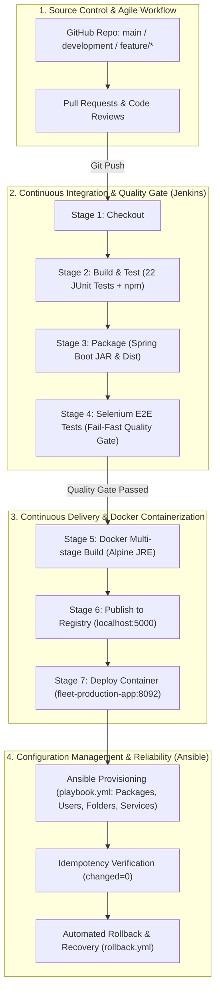

# Fleet Maintenance Management System

[](http://localhost:8080/job/Fleet-maintenance-Pipeline)
[](Dockerfile)
[](ansible/playbook.yml)
[-success)](selenium-tests/)
[](https://github.com/SohanKumar56/fleet-maintenance-system)

Enterprise cloud-native logistics and fleet management platform developed for **ABC Logistics**, featuring a complete **End-to-End DevOps Lifecycle** from agile planning and Git branching workflows through automated unit and Selenium UI quality gates, continuous integration, Docker multi-stage containerization, local private registry publishing, automated container continuous deployment, and Ansible-driven configuration management with disaster recovery rollback.

---

## Architecture & End-to-End DevOps Lifecycle



---

## Complete 15-Task DevOps Implementation Matrix

| Task # | Task Description | Documentation & Deliverables | Status |
|:---:|---|---|:---:|
| **1** | Problem Definition & Scope | [docs/task-1-problem-definition.md](docs/task-1-problem-definition.md) | ✅ Complete |
| **2** | Agile Planning & DevOps Workflow | [docs/task-2-agile-devops.md](docs/task-2-agile-devops.md) | ✅ Complete |
| **3** | Requirements & System Architecture | [docs/task-3-requirements-architecture.md](docs/task-3-requirements-architecture.md) | ✅ Complete |
| **4** | Project Scaffolding & Setup | [backend/](backend/) & [frontend/](frontend/) | ✅ Complete |
| **5** | MVP-01 User Authentication (JWT) | [docs/task-4-completion-summary.md](docs/task-4-completion-summary.md) | ✅ Complete |
| **6** | MVP Core Fleet Management System | [docs/task-6-completion-summary.md](docs/task-6-completion-summary.md) | ✅ Complete |
| **7** | Git Collaboration & Conflict Resolution | Resolved merge conflict commit in Git history | ✅ Complete |
| **8** | Code Review & Pull Request Workflow | [docs/pr-mvp-02-description.md](docs/pr-mvp-02-description.md) | ✅ Complete |
| **9** | Automated Unit & Service Testing (22 Tests) | [docs/task-9-completion-summary.md](docs/task-9-completion-summary.md) | ✅ Complete |
| **10** | Continuous Testing & Quality Gate (Selenium) | [docs/task-10-continuous-testing-summary.md](docs/task-10-continuous-testing-summary.md) | ✅ Complete |
| **11** | Docker Container Lifecycle Management | [docs/task-11-docker-lifecycle.md](docs/task-11-docker-lifecycle.md) | ✅ Complete |
| **12** | Jenkins-Docker Continuous Deployment | [docs/task-12-continuous-deployment.md](docs/task-12-continuous-deployment.md) | ✅ Complete |
| **13** | Configuration Management Script (Ansible) | [docs/task-13-configuration-specification.md](docs/task-13-configuration-specification.md) | ✅ Complete |
| **14** | Automated Provisioning & Reliability | [docs/task-14-provisioning-reliability-validation.md](docs/task-14-provisioning-reliability-validation.md) | ✅ Complete |
| **15** | Final Release, Operations & Viva Defense | [docs/task-15-final-devops-report.md](docs/task-15-final-devops-report.md) | ✅ Complete |

---

## User Roles & Seeded Credentials

The system seeds 3 distinct role-based accounts out of the box:

| Role | Username | Password | Key Permissions & Responsibilities |
|---|---|---|---|
| **Manager** | `manager1` | `manager123` | Fleet inventory CRUD, defect ticket review, mechanic assignment, sign & close completed jobs |
| **Driver** | `driver1` | `driver123` | File defect reports with vehicle selection, view personal report history |
| **Mechanic** | `mechanic1` | `mechanic123` | View assigned job queue, transition tickets to `IN_PROGRESS` and `COMPLETED` |

---

## Technology Stack

- **Backend:** Java 17, Spring Boot 3, Spring Security, JWT, JPA, Hibernate, Embedded Tomcat
- **Frontend:** React 18, Vite, React Router, CSS3 Glassmorphism
- **Testing:** JUnit 5, Mockito, Selenium WebDriver, Chrome Headless, WebDriverManager
- **CI/CD Automation:** Jenkins Declarative Pipeline (7 Stages)
- **Containerization:** Docker (Multi-stage Alpine JRE build), Local Docker Registry (`registry:2`)
- **Configuration Management:** Ansible Core (Idempotent YAML playbooks, Jinja2 templates)
- **Supervision & Reliability:** Systemd service units, Logrotate policies, Zero-downtime rollback

---

## How to Run & Verify

### 1. Run via Docker Continuous Deployment (Production)
```bash
# Query active deployed container health (Port 8092)
curl -i http://localhost:8092/api/auth/health

# Query local Docker registry catalog (Port 5000)
curl -s http://localhost:5000/v2/fleet-maintenance-system/tags/list
```

### 2. Run via Ansible Automation
```bash
# 1. Deploy application container
LC_ALL=C.UTF-8 LANG=C.UTF-8 ansible-playbook -i ansible/inventory.ini ansible/deploy.yml

# 2. Demonstrate Idempotency (observe changed=0)
LC_ALL=C.UTF-8 LANG=C.UTF-8 ansible-playbook -i ansible/inventory.ini ansible/deploy.yml

# 3. Test Automated Disaster Recovery & Rollback
LC_ALL=C.UTF-8 LANG=C.UTF-8 ansible-playbook -i ansible/inventory.ini ansible/rollback.yml
```

### 3. Run Locally for Development
```bash
# Start backend API (Port 8090)
cd backend && mvn spring-boot:run

# Start frontend web client (Port 5173)
cd frontend && npm install && npm run dev
```

### 4. Run Automated Test Suites
```bash
# Execute 22 backend unit & service tests
cd backend && mvn test

# Execute 7 Selenium E2E headless Chrome UI tests
cd selenium-tests && mvn test -Dapp.url=http://localhost:5173
```

---

## Key Documentation Links

- **[Master Project Report (Task 15)](docs/task-15-final-devops-report.md)**: Full architecture, metrics, and technical evaluation.
- **[Operations & Troubleshooting Runbook](docs/task-15-troubleshooting-and-operations-guide.md)**: Real-world diagnostics for Docker, Jenkins, Selenium, and Ansible.
- **[System Limitations & Future Roadmap](docs/task-15-limitations-and-enhancement-plan.md)**: Production gaps and 4-phase Kubernetes/observability roadmap.
- **[Viva Voce Defense & Presentation Guide](docs/task-15-presentation-and-viva-guide.md)**: High-yield interview Q&A and 5-minute live demonstration script.