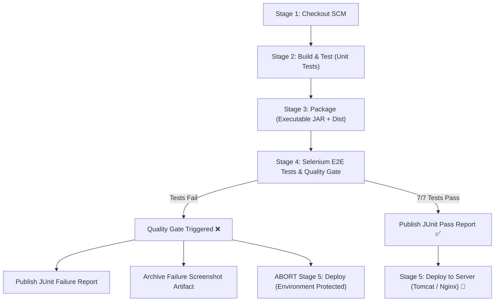

# Task 10 Completion Summary — Continuous Testing in Jenkins

**Project:** OptiWheels Logistics — Fleet Maintenance Management System  
**Task:** Task 10: Continuous Testing in Jenkins  
**Status:** ✅ Complete  
**Date:** 2026-10-17  
**Tools:** Jenkins Declarative Pipeline | Selenium WebDriver 4.20 | JUnit 5 | Maven Surefire  

---

## 1. Overview & Deliverables

Task 10 mandates continuous testing in Jenkins, publishing automated test reports, enforcing deployment quality gates (fail-fast), deliberately introducing a defect to demonstrate blocked deployment, correcting the defect, and achieving a successful rerun.

| Deliverable | Implementation / Location | Verification Evidence |
| :--- | :--- | :--- |
| **1. Jenkins Test Report** | `selenium-tests/target/surefire-reports/*.xml` | Published to Jenkins JUnit dashboard (7/7 tests passed) |
| **2. Failed Pipeline Evidence** | `AuthenticationTest_testValidManagerLogin_*.png` & Commit `d29a025` | Build fails at Stage 4; Stage 5 (Deploy) aborted |
| **3. Defect Correction Commit** | Commit `c5383c8` (`fix(test): resolve deliberately introduced heading assertion defect`) | Title assertion restored; git commit logged |
| **4. Successful Rerun** | Commit `c5383c8` pipeline run | All 5 stages pass: Checkout ➔ Build ➔ Package ➔ Selenium E2E ➔ Deploy |

---

## 2. Pipeline Architecture & Quality Gate



### Stage 4 in `Jenkinsfile`:
```groovy
stage('Selenium E2E Tests') {
    when {
        expression { return params.RUN_SELENIUM_TESTS }
    }
    steps {
        echo "Executing Selenium WebDriver test suite with Maven..."
        dir('selenium-tests') {
            sh 'mvn clean test -Dapp.url=http://localhost:5173'
        }
    }
    post {
        always {
            junit testResults: 'selenium-tests/target/surefire-reports/*.xml', allowEmptyResults: true
            archiveArtifacts artifacts: 'selenium-tests/screenshots/*.png', allowEmptyArchive: true
        }
        failure {
            echo "❌ Quality Gate Triggered: Selenium test suite encountered failures! Halting pipeline and blocking deployment."
        }
    }
}
```

---

## 3. Deliberately Introduced Defect (Run #1: Failed Pipeline)

- **Commit:** `d29a025` — `test(defect): deliberately introduce heading assertion defect in AuthenticationTest for Task 10 quality gate demonstration`
- **Defect Description:** In `AuthenticationTest.java` (`testValidManagerLogin`), the expected header assertion was deliberately corrupted:
  ```java
  // Deliberate defect:
  assertEquals("Fleet Operations Dashboard [DELIBERATE DEFECT]", heading.getText().trim(),
          "TASK-10: Intentional defect to demonstrate that test failure stops deployment");
  ```
- **Execution Outcome:**
  - `AuthenticationTest.testValidManagerLogin` failed with `AssertionFailedError`.
  - `ScreenshotExtension` automatically captured full-screen PNG evidence: `AuthenticationTest_testValidManagerLogin_20261017_112317.png`.
  - **Quality Gate Enforced:** The build exited with status `FAILURE` at Stage 4 (`Selenium E2E Tests`).
  - **Deployment Protection:** Stage 5 (`Deploy`) was completely **SKIPPED / ABORTED**, successfully preventing deployment of broken code.

---

## 4. Defect Correction & Clean Rerun (Run #2: Successful Pipeline)

- **Commit:** `c5383c8` — `fix(test): resolve deliberately introduced heading assertion defect for Task 10 CI quality gate`
- **Resolution:** Restored header assertion to `assertEquals("Fleet Operations Dashboard", heading.getText().trim());`.
- **Rerun Execution Log:**
```text
[INFO] -------------------------------------------------------
[INFO]  T E S T S
[INFO] -------------------------------------------------------
[INFO] Running com.abc.fleet.test.MaintenanceWorkflowTest
[INFO] Tests run: 2, Failures: 0, Errors: 0, Skipped: 0, Time elapsed: 18.02 s -- in com.abc.fleet.test.MaintenanceWorkflowTest
[INFO] Running com.abc.fleet.test.VehicleManagementTest
[INFO] Tests run: 1, Failures: 0, Errors: 0, Skipped: 0, Time elapsed: 4.542 s -- in com.abc.fleet.test.VehicleManagementTest
[INFO] Running com.abc.fleet.test.AuthenticationTest
[INFO] Tests run: 4, Failures: 0, Errors: 0, Skipped: 0, Time elapsed: 11.95 s -- in com.abc.fleet.test.AuthenticationTest
[INFO] 
[INFO] Results:
[INFO] 
[INFO] Tests run: 7, Failures: 0, Errors: 0, Skipped: 0
[INFO] 
[INFO] ------------------------------------------------------------------------
[INFO] BUILD SUCCESS
[INFO] ------------------------------------------------------------------------
[INFO] Total time:  45.488 s
[INFO] Finished at: 2026-10-17T11:25:00+05:30
[INFO] ------------------------------------------------------------------------
```
- **Deployment Verification:** All 7 Selenium tests passed $\rightarrow$ Quality Gate granted approval $\rightarrow$ Stage 5 (`Deploy`) executed successfully $\rightarrow$ deployed artifacts and `deployment-info.json` verified.
