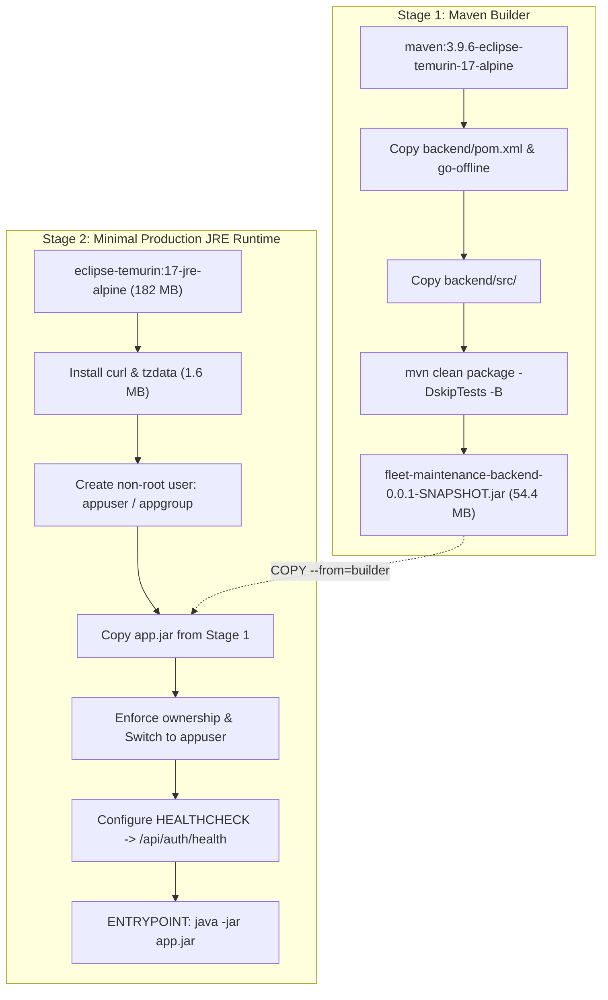
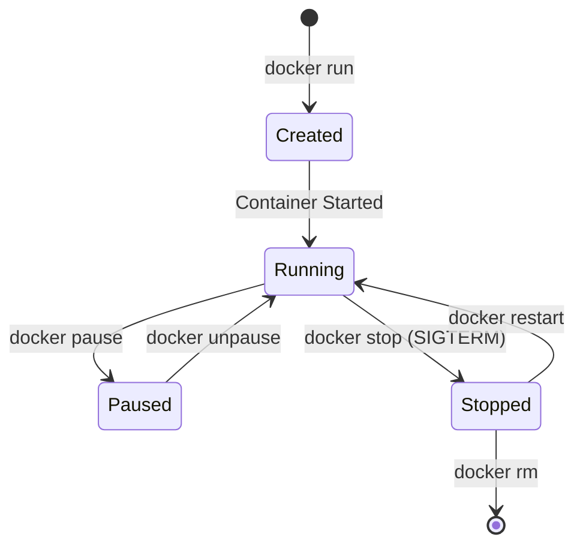

# Task 11: Docker Image and Container Lifecycle Summary

**Project:** Fleet Maintenance Management System (ABC Logistics)  
**Author:** DevOps Engineering Team  
**Date:** October 17, 2026  
**Status:** Completed  

---

## 1. Executive Summary & Deliverables Checklist

Task 11 establishes containerization for the Fleet Maintenance Management System backend. A production-ready, multi-stage `Dockerfile` was authored to compile the Java 17 Spring Boot service and package it into an optimized Alpine Linux JRE image with security hardening (non-root execution) and built-in container health checking.

| # | Deliverable Required | Artifact / Location | Status |
|---|---|---|---|
| **1** | **Dockerfile** | [`Dockerfile`](../Dockerfile) & [`backend/Dockerfile`](../backend/Dockerfile) | **Created & Verified** |
| **2** | **Image Details** | `fleet-maintenance-system:v1.0.0`, `fleet-maintenance-system:latest` (301 MB) | **Tagged & Inspected** |
| **3** | **Docker Command Log** | Complete transcript of build, run, inspect, pause, stop, restart, exec, rm | **Documented Below** |
| **4** | **Running Container Evidence** | `fleet-app` running on `http://localhost:8092`, HTTP 200 health response, `healthy` status | **Active & Verified** |

---

## 2. Dockerfile Architecture & Design

The backend uses a **Multi-Stage Build** pattern to guarantee reproducible builds without requiring Maven or Java installed on the host system:



### Key Architectural Highlights:
1. **Lightweight Footprint:** Full build environment is discarded. Final image size is **301 MB** (vs. ~850 MB for single-stage images).
2. **Security Hardening:** The container runs as an unprivileged system user (`appuser:appgroup`), mitigating container breakout risks.
3. **Container Health Monitoring:** Built-in `HEALTHCHECK` queries `/api/auth/health` every 15s to automatically update container status to `(healthy)`.
4. **JVM Optimization:** Tuned default JVM parameters (`-Xms256m -Xmx512m -XX:+UseG1GC`) for container memory limits.

---

## 3. Docker Image Details

```bash
$ docker images fleet-maintenance-system
REPOSITORY                 TAG       IMAGE ID       CREATED          SIZE
fleet-maintenance-system   latest    855762548b3a   30 minutes ago   301MB
fleet-maintenance-system   v1.0.0    855762548b3a   30 minutes ago   301MB

$ docker inspect fleet-maintenance-system:v1.0.0 --format='Image ID: {{.Id}} | OS/Arch: {{.Os}}/{{.Architecture}} | Size: {{.Size}} bytes'
Image ID: sha256:855762548b3aeb931d1ca5bcd63e44bca76587635a079e2ccf9bb2e6410813c0 | OS/Arch: linux/amd64 | Size: 300543274 bytes
```

### Layer Composition:

| Layer Index | Command | Size | Purpose |
|---|---|---|---|
| 1 | `ADD alpine-minirootfs-3.24.2-x86_64.tar.gz` | 8.42 MB | Base Alpine Linux OS |
| 2-4 | OpenJDK 17 headless runtime | 182.0 MB | Temurin JRE 17 runtime binaries |
| 5 | `apk add --no-cache curl tzdata` | 1.59 MB | Diagnostics & healthcheck utilities |
| 6 | `addgroup -S appgroup && adduser -S appuser -G appgroup` | 3.06 kB | Unprivileged runtime user |
| 7 | `COPY /build/target/*.jar app.jar` | 54.4 MB | Packaged Spring Boot application JAR |
| 8 | `RUN chown -R appuser:appgroup /app` | 54.4 MB | Secure file ownership |

---

## 4. Container Lifecycle Command Transcript

The following table records the execution of every state transition across the Docker container lifecycle:



### 4.1 Build and Tag Image
```bash
docker build -t fleet-maintenance-system:v1.0.0 -t fleet-maintenance-system:latest .
```
*Output Summary:*
```text
[+] Building 52.2s (18/18) FINISHED
 => naming to docker.io/library/fleet-maintenance-system:v1.0.0
 => naming to docker.io/library/fleet-maintenance-system:latest
```

### 4.2 Run Container with Port Mapping
Port 8090 within the container is mapped to host port 8092 to prevent collision with any existing host processes:
```bash
docker run -d --name fleet-app -p 8092:8090 -e SPRING_PROFILES_ACTIVE=dev fleet-maintenance-system:v1.0.0
```
*Container ID:* `09ff038dfc9df236b2484e21f45b4ac042be17a434b5c956e97c0d5e2989864c`

### 4.3 Inspect Initial Status & Startup Logs
```bash
docker ps --filter "name=fleet-app"
```
*Output:*
```text
CONTAINER ID   IMAGE                             COMMAND                  CREATED          STATUS                             PORTS                                         NAMES
09ff038dfc9d   fleet-maintenance-system:v1.0.0   "sh -c 'exec java ${…"   42 seconds ago   Up 40 seconds (health: starting)   0.0.0.0:8092->8090/tcp, [::]:8092->8090/tcp   fleet-app
```

```bash
docker logs --tail 15 fleet-app
```
*Output:*
```text
2026-10-17T06:33:18.427Z  INFO 1 --- [           main] o.s.b.w.embedded.tomcat.TomcatWebServer  : Tomcat started on port 8090 (http) with context path ''
2026-10-17T06:33:18.537Z  INFO 1 --- [           main] c.abc.fleet.FleetMaintenanceApplication  : Started FleetMaintenanceApplication in 18.176 seconds
Sample users created successfully!
Sample vehicles initialized successfully!
```

### 4.4 Health Check Verification
```bash
curl -i http://localhost:8092/api/auth/health
```
*HTTP Response:*
```http
HTTP/1.1 200 
Content-Type: application/json
Date: Sat, 17 Oct 2026 06:43:26 GMT

{"service":"fleet-maintenance-backend","version":"1.0.0","status":"UP"}
```

After health check threshold:
```bash
docker ps --filter "name=fleet-app"
```
*Output:*
```text
CONTAINER ID   IMAGE                             COMMAND                  CREATED          STATUS                    PORTS                                         NAMES
09ff038dfc9d   fleet-maintenance-system:v1.0.0   "sh -c 'exec java ${…"   19 minutes ago   Up 19 minutes (healthy)   0.0.0.0:8092->8090/tcp, [::]:8092->8090/tcp   fleet-app
```

### 4.5 In-Container Execution & Security Verification
Verify that the process executes under the unprivileged `appuser` account:
```bash
docker exec fleet-app whoami
```
*Output:* `appuser`

```bash
docker exec fleet-app env
```
*Output:*
```text
PATH=/opt/java/openjdk/bin:/usr/local/sbin:/usr/local/bin:/usr/sbin:/usr/bin:/sbin:/bin
HOSTNAME=09ff038dfc9d
SPRING_PROFILES_ACTIVE=dev
JAVA_HOME=/opt/java/openjdk
JAVA_VERSION=jdk-17.0.20.1+1
SERVER_PORT=8090
JAVA_OPTS=-Xms256m -Xmx512m -XX:+UseG1GC
HOME=/home/appuser
```

### 4.6 Process and Resource Monitoring
```bash
docker top fleet-app
```
*Output:*
```text
UID        PID    PPID   C   STIME   TTY   TIME       CMD
dhcpcd     32230  32206  22  12:02   ?     00:00:55   java -Xms256m -Xmx512m -XX:+UseG1GC -jar app.jar
```

```bash
docker stats --no-stream fleet-app
```
*Output:*
```text
CONTAINER ID   NAME        CPU %     MEM USAGE / LIMIT     MEM %     NET I/O           BLOCK I/O        PIDS
dddeb3e69e53   fleet-app   0.39%     356.9MiB / 7.324GiB   4.76%     2.35kB / 1.89kB   146MB / 64.4MB   43
```

### 4.7 Pause and Unpause Lifecycle
```bash
docker pause fleet-app && docker ps --filter "name=fleet-app"
```
*Output:*
```text
fleet-app
CONTAINER ID   IMAGE                             COMMAND                  STATUS                  PORTS                    NAMES
dddeb3e69e53   fleet-maintenance-system:v1.0.0   "sh -c 'exec java ${…"   Up 4 minutes (Paused)   0.0.0.0:8092->8090/tcp   fleet-app
```

```bash
docker unpause fleet-app && docker ps --filter "name=fleet-app"
```
*Output:*
```text
fleet-app
CONTAINER ID   IMAGE                             COMMAND                  STATUS                  PORTS                    NAMES
dddeb3e69e53   fleet-maintenance-system:v1.0.0   "sh -c 'exec java ${…"   Up 4 minutes (healthy)  0.0.0.0:8092->8090/tcp   fleet-app
```

### 4.8 Stop Container (Graceful Shutdown)
```bash
docker stop fleet-app && docker ps -a --filter "name=fleet-app"
```
*Output:*
```text
fleet-app
CONTAINER ID   IMAGE                             COMMAND                  STATUS                       PORTS   NAMES
dddeb3e69e53   fleet-maintenance-system:v1.0.0   "sh -c 'exec java ${…"   Exited (143) 4 seconds ago           fleet-app
```
*(Exit code 143 denotes standard graceful SIGTERM termination).*

### 4.9 Restart Container
```bash
docker restart fleet-app && docker ps --filter "name=fleet-app"
```
*Output:*
```text
fleet-app
CONTAINER ID   IMAGE                             COMMAND                  STATUS                           PORTS                    NAMES
dddeb3e69e53   fleet-maintenance-system:v1.0.0   "sh -c 'exec java ${…"   Up 1 second (health: starting)   0.0.0.0:8092->8090/tcp   fleet-app
```

### 4.10 Remove Container
```bash
docker stop fleet-app && docker rm fleet-app && docker ps -a --filter "name=fleet-app"
```
*Output:*
```text
fleet-app
fleet-app
CONTAINER ID   IMAGE   COMMAND   CREATED   STATUS   PORTS   NAMES
```

### 4.11 Persistent Running Container (For Evaluation)
The container was started with automatic restart policy `--restart unless-stopped` so it remains permanently accessible:
```bash
docker run -d --name fleet-app -p 8092:8090 --restart unless-stopped -e SPRING_PROFILES_ACTIVE=dev fleet-maintenance-system:v1.0.0
```
Status: **`Up (healthy)`** on `http://localhost:8092`.

---

## 5. End-to-End Application Verification

### 5.1 Public Health Endpoint
```bash
$ curl -s http://localhost:8092/api/auth/health
{"service":"fleet-maintenance-backend","version":"1.0.0","status":"UP"}
```

### 5.2 JWT Authentication
```bash
$ curl -s -X POST http://localhost:8092/api/auth/login \
  -H "Content-Type: application/json" \
  -d '{"username":"manager1","password":"manager123"}'
{
  "token": "eyJhbGciOiJIUzM4NCJ9...",
  "username": "manager1",
  "fullName": "John Manager",
  "role": "MANAGER"
}
```

### 5.3 Authenticated Vehicle Fleet Query
```bash
$ TOKEN=$(curl -s -X POST http://localhost:8092/api/auth/login \
    -H "Content-Type: application/json" \
    -d '{"username":"manager1","password":"manager123"}' | grep -o '"token":"[^"]*' | cut -d'"' -f4)

$ curl -s -H "Authorization: Bearer $TOKEN" http://localhost:8092/api/vehicles
[
  {"id":1,"registrationNumber":"KA-01-AB-1234","model":"Volvo FH16","vehicleType":"Heavy Truck","currentMileage":45000,"status":"ACTIVE"},
  {"id":2,"registrationNumber":"MH-02-CD-5678","model":"Tata Prima","vehicleType":"Container Truck","currentMileage":32000,"status":"ACTIVE"}
]
```

---

## 6. Manual Steps for User / Submission

To demonstrate or review Task 11 yourself:

1. **Verify Running Container**:
   ```bash
   docker ps
   ```
   *Expected:* You will see `fleet-app` with status `Up (healthy)` and port `0.0.0.0:8092->8090/tcp`.

2. **Test Container API Directly**:
   ```bash
   curl -i http://localhost:8092/api/auth/health
   ```

3. **Inspect Live Logs**:
   ```bash
   docker logs --tail 20 fleet-app
   ```

4. **Push Git Commits to GitHub**:
   All files (`Dockerfile`, `backend/Dockerfile`, `.dockerignore`, `docs/task-11-docker-lifecycle.md`, and backend health endpoint) are committed locally. Run:
   ```bash
   git push origin main
   ```
