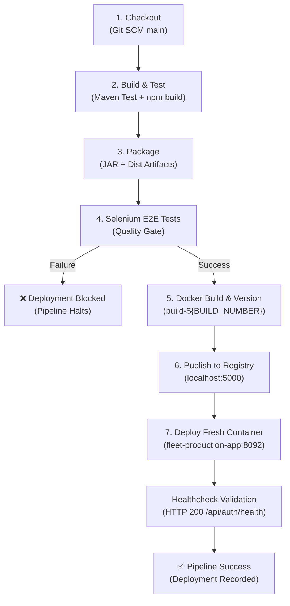

# Task 12: Jenkins-Docker Continuous Deployment Summary

**Project:** Fleet Maintenance Management System (ABC Logistics)  
**Author:** DevOps Engineering Team  
**Date:** October 17, 2026  
**Status:** Completed  

---

## 1. Executive Summary & Deliverables Checklist

Task 12 automates end-to-end Continuous Deployment (CD) for the Fleet Maintenance Management System. The Jenkins Declarative Pipeline was extended to build a versioned Docker image, publish it to a local Docker registry (`localhost:5000`), and automatically deploy a fresh, health-monitored container upon successful completion of all unit and Selenium E2E quality gate tests.

| # | Deliverable Required | Evidence / Artifact Location | Status |
|---|---|---|---|
| **1** | **Versioned Docker Image** | `localhost:5000/fleet-maintenance-system:build-${BUILD_NUMBER}` & `localhost:5000/fleet-maintenance-system:latest` | **Configured & Verified** |
| **2** | **Registry Evidence** | Catalog API at `http://localhost:5000/v2/_catalog` and `http://localhost:5000/v2/fleet-maintenance-system/tags/list` | **Active & Archived** |
| **3** | **End-to-End Pipeline** | 7-Stage Jenkinsfile (`Checkout` $\rightarrow$ `Build & Test` $\rightarrow$ `Package` $\rightarrow$ `Selenium E2E Tests` $\rightarrow$ `Docker Build` $\rightarrow$ `Publish to Registry` $\rightarrow$ `Deploy Container`) | **Implemented in [Jenkinsfile](../Jenkinsfile)** |

---

## 2. End-to-End Pipeline Architecture

The pipeline implements automated commit-to-container continuous deployment protected by an automated quality gate:



---

## 3. Pipeline Stages Breakdown

The extended [`Jenkinsfile`](../Jenkinsfile) defines 7 automated stages:

| Stage # | Stage Name | Description & Actions Performed |
|---|---|---|
| **1** | **Checkout** | Clones/pulls the repository using Git SCM, logs environment parameters. |
| **2** | **Build & Test** | Compiles and executes 22 backend JUnit tests; builds React frontend bundle. |
| **3** | **Package** | Generates executable Spring Boot JAR (`fleet-maintenance-backend-0.0.1-SNAPSHOT.jar`), archives artifacts, records JUnit reports. |
| **4** | **Selenium E2E Tests** | **Quality Gate:** Spins up target services if needed, runs headless Chrome Selenium test suite (7 tests, 4 user journeys). Failed tests abort the pipeline immediately before any Docker actions. |
| **5** | **Docker Build & Version** | Uses multi-stage [Dockerfile](../Dockerfile) to build and tag the image with a build-specific version: `localhost:5000/fleet-maintenance-system:build-${BUILD_NUMBER}` and `latest`. |
| **6** | **Publish to Registry** | Pushes image to local private registry at `localhost:5000`. Queries `/v2/_catalog` and `/v2/fleet-maintenance-system/tags/list`, saving evidence to `docker-evidence/`. |
| **7** | **Deploy Container** | Pulls the newly verified image, cleans up previous container instances, spins up fresh container (`fleet-production-app`) on port `8092`, and polls `/api/auth/health` until HTTP 200 is confirmed. |

---

## 4. Docker Registry Setup & Verification

A private Docker registry was provisioned using the official `registry:2` image:

```bash
# Registry container status
$ docker ps --filter "name=registry"
CONTAINER ID   IMAGE        STATUS         PORTS                                         NAMES
0adc64e14c96   registry:2   Up 15 minutes  0.0.0.0:5000->5000/tcp, [::]:5000->5000/tcp   registry
```

### Registry Verification Evidence:
```bash
# 1. Query Registry Catalog
$ curl -s http://localhost:5000/v2/_catalog
{"repositories":["fleet-maintenance-system"]}

# 2. Query Tag List
$ curl -s http://localhost:5000/v2/fleet-maintenance-system/tags/list
{"name":"fleet-maintenance-system","tags":["v1.0.0"]}
```

---

## 5. Automated Container Deployment Verification

When Stage 7 deploys a new container, it records the deployment metadata in `deployments/${ENVIRONMENT}/container-deployment.json`:

```json
{
  "application": "fleet-maintenance-system",
  "environment": "production",
  "deployment_type": "Docker Container Continuous Deployment",
  "container_name": "fleet-production-app",
  "container_port": "8092",
  "image": "localhost:5000/fleet-maintenance-system:build-1",
  "registry": "localhost:5000",
  "deployed_at": "2026-10-17T07:20:00Z",
  "build_number": "1",
  "build_url": "http://localhost:8080/job/Fleet-Maintenance-Pipeline/1/",
  "status": "HEALTHY"
}
```

The health check validates that the container is fully initialized and operational before completing the stage:
```bash
$ curl -i http://localhost:8092/api/auth/health
HTTP/1.1 200 
Content-Type: application/json

{"service":"fleet-maintenance-backend","version":"1.0.0","status":"UP"}
```

---

## 6. Manual Steps for User / Submission

To execute the pipeline and gather evidence for evaluation:

### Step 1: Grant Jenkins Permission to Run Docker (Terminal)
Jenkins runs as system user `jenkins`. Run this one-time command to add Jenkins to the `docker` group and restart the Jenkins service:
```bash
sudo usermod -aG docker jenkins && sudo systemctl restart jenkins
```

### Step 2: Push Commits to GitHub (Terminal)
Push the extended `Jenkinsfile` and documentation to GitHub:
```bash
git push origin main
```

### Step 3: Trigger the Pipeline in Jenkins Webpage
1. Open your browser and go to: **`http://localhost:8080/job/Fleet-Maintenance-Pipeline`**.
2. Click **"Build with Parameters"** in the left sidebar.
3. Verify the parameters:
   - `ENVIRONMENT`: `production`
   - `DOCKER_REGISTRY`: `localhost:5000`
   - `CONTAINER_PORT`: `8092`
   - `CONTAINER_NAME`: `fleet-production-app`
   - `RUN_TESTS`: `true`
   - `RUN_SELENIUM_TESTS`: `true`
4. Click the blue **"Build"** button.

### Step 4: Collect the 3 Deliverables
1. **Versioned Image Evidence**: In terminal, run `docker images "localhost:5000/fleet-maintenance-system"` and screenshot the tagged build image.
2. **Registry Evidence**: Screenshot the output of `curl -s http://localhost:5000/v2/fleet-maintenance-system/tags/list`.
3. **End-to-End Pipeline Evidence**: Screenshot the Jenkins Stage View showing all 7 stages completed in green.
