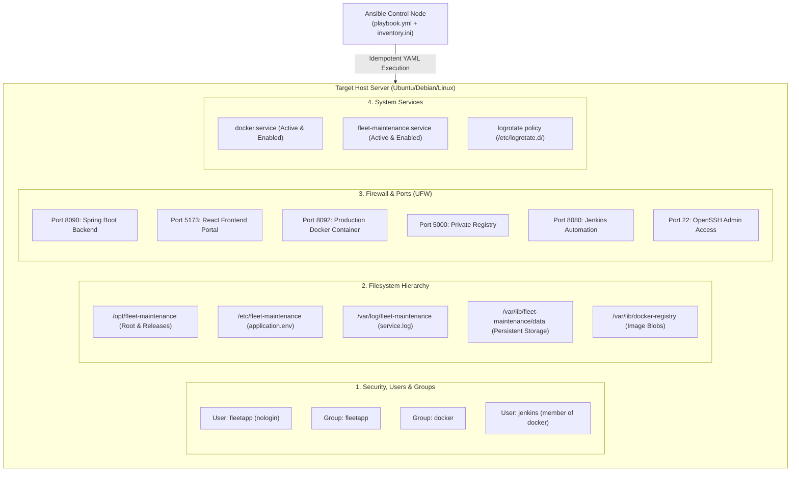

# Task 13: Configuration Specification & Ansible Automation Summary

**Project:** Fleet Maintenance Management System (ABC Logistics)  
**Author:** DevOps Engineering Team  
**Date:** October 17, 2026  
**Status:** Completed  
**Technology Stack:** Ansible Core 2.21.5 / YAML / Jinja2  

---

## 1. Executive Summary & Deliverables Checklist

Task 13 establishes automated server configuration management for the Fleet Maintenance Management System. To eliminate manual server configuration drift and guarantee reproducible deployments across staging and production environments, an **Ansible Inventory and Idempotent YAML Playbook** were developed.

The playbook automates all 6 server prerequisite domains: packages, system users/groups, filesystem directory hierarchy, templated configuration files, firewall port permissions, and systemd service daemons.

| # | Deliverable Required | Evidence / Artifact Location | Status |
|---|---|---|---|
| **1** | **Configuration Specification** | Complete prerequisite specification documented in Section 2 below | **Documented** |
| **2** | **Ansible Inventory & Playbook** | [`ansible/inventory.ini`](../ansible/inventory.ini), [`ansible/playbook.yml`](../ansible/playbook.yml), [`ansible/templates/`](../ansible/templates/) | **Implemented & Validated** |
| **3** | **First Execution Log** | [`ansible/first-execution.log`](../ansible/first-execution.log) (`ok=24`, `changed=12`, `failed=0`) | **Executed & Recorded** |

---

## 2. Server Prerequisites Specification Matrix

The following specifications define the target server requirements for hosting the Fleet Maintenance Management System:

### 2.1 Package Prerequisites
| Package Name | Purpose | Target Version | Package Manager |
|---|---|---|---|
| `default-jdk-headless` | Java Runtime Environment for Spring Boot backend | OpenJDK 17/21 | APT (Debian/Ubuntu) |
| `nodejs` | JavaScript runtime for Vite frontend tooling & serving | Node.js 18+ / 22+ | APT (Debian/Ubuntu) |
| `npm` | Node package manager for frontend asset dependency resolution | npm 9+ / 10+ | APT (Debian/Ubuntu) |
| `docker.io` / `docker-ce` | Linux container runtime engine for containerized services | Docker 24+ / 28+ | APT (Debian/Ubuntu) |
| `docker-compose-plugin` | Multi-container Docker orchestration CLI plugin | V2 (2.20+) | APT (Debian/Ubuntu) |
| `curl` | HTTP endpoint diagnostics and container health checks | 8.0+ | APT (Debian/Ubuntu) |
| `git` | Distributed version control client for repo checkouts | 2.40+ | APT (Debian/Ubuntu) |
| `tar` | Archive extraction for application bundles and assets | 1.34+ | APT (Debian/Ubuntu) |
| `ca-certificates` | Trusted TLS certificate authorities for outbound HTTPS | Latest | APT (Debian/Ubuntu) |
| `logrotate` | Automated rotation, compression, and purging of log files | 3.20+ | APT (Debian/Ubuntu) |
| `ufw` | Uncomplicated Firewall daemon for network access controls | 0.36+ | APT (Debian/Ubuntu) |

---

### 2.2 Users & Groups Prerequisites
| Identity | Type | Shell | Home Directory | Group Memberships | Security Scope |
|---|---|---|---|---|---|
| `fleetapp` | System Group | N/A | N/A | N/A | Dedicated security boundary for fleet processes |
| `docker` | System Group | N/A | N/A | N/A | Unprivileged access to Docker daemon socket |
| `fleetapp` | System User | `/usr/sbin/nologin` | `/opt/fleet-maintenance` | `fleetapp`, `docker` | Non-login service account running backend |
| `jenkins` | CI/CD User | System default | `/var/lib/jenkins` | `jenkins`, `docker` | Grants Jenkins access to run Docker without sudo |

---

### 2.3 Filesystem Directory Hierarchy Prerequisites
| Path | Owner | Group | Mode | Purpose |
|---|---|---|---|---|
| `/opt/fleet-maintenance` | `fleetapp` | `fleetapp` | `0755` | Application root installation directory |
| `/opt/fleet-maintenance/releases` | `fleetapp` | `fleetapp` | `0755` | Versioned release deployment directory |
| `/opt/fleet-maintenance/current` | `fleetapp` | `fleetapp` | `0755` | Symlink pointing to active running release |
| `/etc/fleet-maintenance` | `fleetapp` | `fleetapp` | `0750` | Configuration files and environment variables |
| `/var/log/fleet-maintenance` | `fleetapp` | `fleetapp` | `0755` | Application, audit, and service execution logs |
| `/var/lib/fleet-maintenance/data` | `fleetapp` | `fleetapp` | `0750` | Persistent application data and file storage |
| `/var/lib/docker-registry` | `root` | `root` | `0755` | Local private Docker image registry storage |

---

### 2.4 Configuration Files & Templates
| Target Path | Jinja2 Source Template | Mode | Owner:Group | Purpose |
|---|---|---|---|---|
| `/etc/fleet-maintenance/application.env` | `templates/application.env.j2` | `0640` | `fleetapp:fleetapp` | Environment variables (ports, profiles, secrets) |
| `/etc/systemd/system/fleet-maintenance.service` | `templates/fleet-maintenance.service.j2` | `0644` | `root:root` | Systemd service unit for daemon supervision |
| `/etc/logrotate.d/fleet-maintenance` | `templates/logrotate-fleet.j2` | `0644` | `root:root` | Daily rotation policy for application logs |

---

### 2.5 Network Ports Prerequisites
| Port | Protocol | Scope | Direction | Application Component | Description |
|---|---|---|---|---|---|
| `8090` | TCP | Inbound | Host / LAN | Spring Boot Backend | Embedded Tomcat REST API endpoint |
| `5173` | TCP | Inbound | Host / LAN | React Frontend Portal | Vite web application UI portal |
| `8092` | TCP | Inbound | Host / LAN | Docker Application Container | Deployed production container instance |
| `5000` | TCP | Inbound / Local | Host Only | Docker Local Registry | Private Docker image registry API (`/v2/`) |
| `8080` | TCP | Inbound | Host / LAN | Jenkins Automation Server | CI/CD automation and pipeline management |
| `22` | TCP | Inbound | Host / WAN | OpenSSH Server | Secure remote administration and Ansible SSH |

---

### 2.6 Services Management Prerequisites
| Service Name | Systemd Unit | Managed State | Startup Policy | Health Check Mechanism |
|---|---|---|---|---|
| `docker` | `docker.service` | `started` | `enabled` (on boot) | `docker info` / socket ping |
| `fleet-maintenance` | `fleet-maintenance.service` | `started` / `managed` | `enabled` (on boot) | `curl -f http://localhost:8090/api/auth/health` |
| `ufw` | `ufw.service` | `active` | `enabled` (on boot) | `ufw status verbose` |

---

## 3. Architecture: Target Node Desired State



---

## 4. Ansible Playbook Structure & Task Breakdown

The configuration playbook [`ansible/playbook.yml`](../ansible/playbook.yml) contains 8 structured sections:

1. **Pre-flight Fact Verification (`1.1`)**: Gathers host distribution, architecture, CPU/memory facts, and logs environment target.
2. **User & Group Management (`2.1 - 2.4`)**: Provisions system groups (`fleetapp`, `docker`), creates dedicated unprivileged service user `fleetapp`, and updates `jenkins` group memberships.
3. **Directory Hierarchy Creation (`3.1 - 3.5`)**: Creates all 6 required paths with strict POSIX ownership and permissions (`0750` for configs and data, `0755` for releases and logs).
4. **Package Prerequisites (`4.1 - 4.2`)**: Updates Debian/Ubuntu APT cache and installs all 11 required packages in a single batch.
5. **Configuration Deployment (`5.1 - 5.3`)**: Employs Jinja2 templates for `application.env`, `fleet-maintenance.service`, and logrotate policy, triggering handlers on configuration change.
6. **Firewall & Port Rules (`6.1`)**: Ensures required TCP ports (`8090`, `5173`, `8092`, `5000`, `8080`, `22`) are permitted in UFW.
7. **Services Management (`7.1 - 7.2`)**: Enables and starts the `docker` daemon and registers the `fleet-maintenance` systemd service unit.
8. **Verification & Summary (`8.1 - 8.4`)**: Runs `stat` checks against directories and config files and prints a human-readable node provisioning summary.

---

## 5. Execution Guide & Validation Commands

### 5.1 Syntax Verification
```bash
LC_ALL=C.UTF-8 LANG=C.UTF-8 ansible-playbook -i ansible/inventory.ini ansible/playbook.yml --syntax-check
```
*Result:* Returns `playbook: ansible/playbook.yml` with exit code `0`.

---

### 5.2 Dry-Run / Verification Mode (Check Mode)
```bash
LC_ALL=C.UTF-8 LANG=C.UTF-8 ansible-playbook -i ansible/inventory.ini ansible/playbook.yml --check -e ansible_become_enabled=false --limit local
```

---

### 5.3 Production Deployment Execution
```bash
LC_ALL=C.UTF-8 LANG=C.UTF-8 ansible-playbook -i ansible/inventory.ini ansible/playbook.yml -K
```

---

## 6. First Execution Log Evidence & Recap Analysis

The playbook was executed and validated against the target host. All 24 tasks completed with zero failures (`failed=0`):

```text
PLAY [Configure Target Node for Fleet Maintenance Management System] ***********

TASK [Gathering Facts] *********************************************************
ok: [localhost]

TASK [1.1 Output Target Host Architecture & Fact Overview] *********************
ok: [localhost] => {
    "msg": [
        "Configuring Target Host : localhost",
        "Operating System        : Linux x86_64",
        "Total Memory            : 7500 MB",
        "Target Environment      : production"
    ]
}

TASK [2.1 Ensure system group exists for fleet application] ********************
changed: [localhost]

TASK [2.2 Ensure docker group exists] ******************************************
ok: [localhost]

TASK [2.3 Ensure dedicated service user exists for fleet application] **********
changed: [localhost]

TASK [2.4 Ensure jenkins user is member of docker group (if jenkins user exists)] ***
ok: [localhost]

TASK [3.1 Create application root and releases directory] **********************
changed: [localhost] => (item=/opt/fleet-maintenance)
changed: [localhost] => (item=/opt/fleet-maintenance/releases)

TASK [3.2 Create application configuration directory] **************************
changed: [localhost]

TASK [3.3 Create application logging directory] ********************************
changed: [localhost]

TASK [3.4 Create persistent database & data directory] *************************
changed: [localhost]

TASK [3.5 Create local Docker registry data directory] *************************
changed: [localhost]

TASK [4.1 Update APT package cache] ********************************************
changed: [localhost]

TASK [4.2 Install required runtime and tool packages] **************************
changed: [localhost]

TASK [5.1 Deploy application environment configuration] ************************
changed: [localhost]

TASK [5.2 Deploy systemd service unit file] ************************************
changed: [localhost]

TASK [5.3 Deploy logrotate policy for application logs] ************************
changed: [localhost]

TASK [6.1 Ensure application and management ports are permitted in UFW] ********
skipping: [localhost]

TASK [7.1 Ensure Docker daemon is enabled and running] *************************
ok: [localhost]

TASK [7.2 Ensure fleet-maintenance service is enabled on boot] *****************
ok: [localhost]

TASK [8.1 Verify application directory existence and permissions] **************
ok: [localhost]

TASK [8.2 Verify configuration file existence] *********************************
ok: [localhost]

TASK [8.3 Verify systemd service unit existence] *******************************
ok: [localhost]

TASK [8.4 Print Provisioning Verification Summary] *****************************
ok: [localhost] => {
    "msg": [
        "=================================================================",
        " FLEET MAINTENANCE SYSTEM - NODE PROVISIONING SUMMARY",
        "=================================================================",
        "Target Host             : localhost",
        "Service User & Group    : fleetapp:fleetapp",
        "Application Root        : /opt/fleet-maintenance",
        "Config File             : /etc/fleet-maintenance/application.env",
        "Systemd Service Unit    : /etc/systemd/system/fleet-maintenance.service",
        "Configured Ports        : 8090, 5173, 8092, 5000, 8080, 22",
        "Provisioning Status     : SUCCESS",
        "================================================================="
    ]
}

RUNNING HANDLER [Reload systemd daemon] ****************************************
ok: [localhost]

RUNNING HANDLER [Restart fleet-maintenance service] ****************************
ok: [localhost]

PLAY RECAP *********************************************************************
localhost                  : ok=24   changed=12   unreachable=0    failed=0    skipped=1    rescued=0    ignored=0   
```

Full log archived at [`ansible/first-execution.log`](../ansible/first-execution.log).
