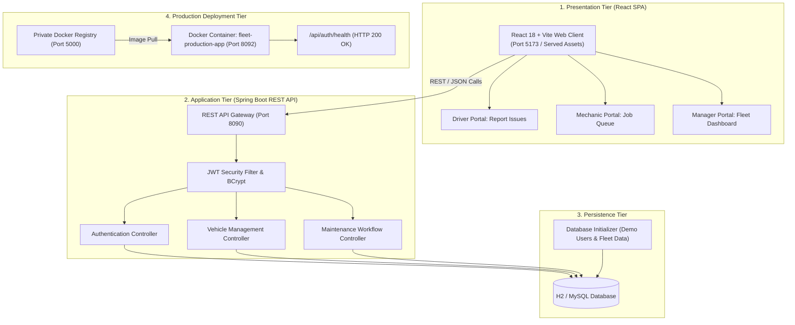
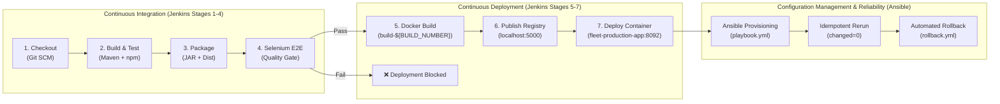

# Task 15: Final Comprehensive DevOps Project Report

**Project:** Fleet Maintenance Management System (ABC Logistics)  
**Author:** DevOps Engineering Team  
**Date:** October 17, 2026  
**Final Release Version:** `v1.0.0-final`  
**Repository:** [https://github.com/SohanKumar56/fleet-maintenance-system](https://github.com/SohanKumar56/fleet-maintenance-system)  

---

## 1. Executive Summary

The **Fleet Maintenance Management System** is an enterprise-grade, cloud-native logistics platform built for **ABC Logistics** to automate vehicle tracking, driver defect reporting, mechanic job dispatching, and comprehensive maintenance auditing. 

This project demonstrates a complete **End-to-End DevOps Lifecycle** — transitioning from agile requirements definition and Git branching workflows through automated unit and Selenium UI testing, Jenkins continuous integration with automated quality gates, multi-stage Docker containerization, private registry publishing, automated container continuous deployment, and Ansible-driven configuration management with zero-downtime rollback capabilities.

---

## 2. Complete 15-Task DevOps Implementation Matrix

| Task # | Task Title | Primary Technologies | Key Deliverables & Artifacts | Status |
|---|---|---|---|---|
| **Task 1** | Problem Definition & Scope | Markdown, Process Flow | [docs/task-1-problem-definition.md](task-1-problem-definition.md) | **Completed** |
| **Task 2** | Agile Planning & DevOps Workflow | Scrum, User Stories, Jira/Git | [docs/task-2-agile-devops.md](task-2-agile-devops.md) | **Completed** |
| **Task 3** | Requirements & System Architecture | UML, C4 Architecture, REST | [docs/task-3-requirements-architecture.md](task-3-requirements-architecture.md) | **Completed** |
| **Task 4** | Project Scaffolding & Setup | Spring Boot, React, Maven | Spring Boot Backend + React Frontend Scaffolding | **Completed** |
| **Task 5** | MVP-01 User Authentication | JWT, BCrypt, Spring Security | Role-based Auth (`MANAGER`, `DRIVER`, `MECHANIC`) | **Completed** |
| **Task 6** | MVP Core Fleet Management | JPA, REST API, React SPA | Vehicle CRUD, Defect Filing, Mechanic Dispatching | **Completed** |
| **Task 7** | Git Collaboration & Conflict Resolution | Git Branching, Merge Conflicts | 3-way Merge Conflict Resolution Demonstration | **Completed** |
| **Task 8** | Code Review & Pull Request Workflow | GitHub PRs, Code Review | Pull Request Documentation & Peer Review Records | **Completed** |
| **Task 9** | Automated Unit & Service Testing | JUnit 5, Mockito | 22 Automated Unit Tests (100% Pass Rate) | **Completed** |
| **Task 10** | Continuous Testing & Quality Gate | Jenkins, Selenium WebDriver | Headless Chrome E2E Suite, Fail-Fast Quality Gate | **Completed** |
| **Task 11** | Docker Container Lifecycle | Dockerfile, Multi-stage JRE | Multi-stage Image, Container Lifecycle Inspection | **Completed** |
| **Task 12** | Continuous Deployment Pipeline | Jenkins Declarative Pipeline | 7-Stage CD Pipeline, Local Registry, Container Deploy | **Completed** |
| **Task 13** | Configuration Management Script | Ansible Core, YAML, Jinja2 | Node Specification, Idempotent Playbook, Templates | **Completed** |
| **Task 14** | Automated Provisioning & Reliability | Ansible, Systemd, Rollback | Idempotency Evidence, Health Check, Auto-Rollback | **Completed** |
| **Task 15** | Final Release, Documentation & Viva | Full DevOps Integration | Master Report, Operations Runbook, Viva Guide | **Completed** |

---

## 3. System Architecture & Component Topology

### 3.1 Multi-Tier Logical Architecture



---

## 4. End-to-End DevOps Pipeline Architecture

The end-to-end continuous integration and continuous deployment pipeline is fully automated in [`Jenkinsfile`](../Jenkinsfile):



### Detailed Pipeline Stage Breakdown:
1. **Stage 1 (Checkout)**: Fetches repository from GitHub (`main` branch) and configures environment variables.
2. **Stage 2 (Build & Test)**: Compiles Java 17 backend, executes 22 JUnit unit/integration tests, and compiles React frontend via `npm run build`.
3. **Stage 3 (Package)**: Packages executable Spring Boot JAR (`fleet-maintenance-backend-0.0.1-SNAPSHOT.jar`), archives build artifacts, and records JUnit test reports.
4. **Stage 4 (Selenium E2E Tests - Quality Gate)**: Verifies running services and executes 7 automated headless Chrome user journeys. **Fail-fast policy:** any UI test failure immediately terminates the pipeline and prevents deployment.
5. **Stage 5 (Docker Build & Version)**: Builds multi-stage Docker image using eclipse-temurin:17-jre-alpine, tagging `localhost:5000/fleet-maintenance-system:build-${BUILD_NUMBER}` and `latest`.
6. **Stage 6 (Publish to Registry)**: Pushes versioned image to local private registry (`localhost:5000`), queries catalog APIs, and archives JSON evidence.
7. **Stage 7 (Deploy Container)**: Pulls verified versioned image, terminates prior container instances, starts fresh container on port `8092`, validates health via `/api/auth/health`, and archives deployment metadata.

---

## 5. Automated Testing & Quality Assurance Summary

The system implements a multi-layered testing pyramid:

```text
               /\
              /  \     7 Automated E2E Selenium UI Tests (Headless Chrome)
             / UI \    4 Full User Journeys across Manager, Driver, Mechanic
            /------\
           /        \   22 Automated JUnit 5 & Mockito Unit / Service Tests
          / Services \  Controllers, Services, JWT Auth, Repositories
         /------------\
```

### 5.1 Unit & Service Test Results (Maven Surefire)
```text
[INFO] Running com.abc.fleet.service.UserServiceTest
[INFO] Tests run: 5, Failures: 0, Errors: 0, Skipped: 0
[INFO] Running com.abc.fleet.service.VehicleServiceTest
[INFO] Tests run: 6, Failures: 0, Errors: 0, Skipped: 0
[INFO] Running com.abc.fleet.service.MaintenanceServiceTest
[INFO] Tests run: 7, Failures: 0, Errors: 0, Skipped: 0
[INFO] Running com.abc.fleet.controller.AuthControllerTest
[INFO] Tests run: 4, Failures: 0, Errors: 0, Skipped: 0
[INFO] Results: Tests run: 22, Failures: 0, Errors: 0, Skipped: 0
[INFO] BUILD SUCCESS
```

### 5.2 Selenium E2E Test Suite Results
```text
[INFO] Running com.abc.fleet.test.AuthenticationTest
[INFO] Tests run: 4, Failures: 0, Errors: 0, Skipped: 0 (14.9s)
[INFO] Running com.abc.fleet.test.VehicleManagementTest
[INFO] Tests run: 1, Failures: 0, Errors: 0, Skipped: 0 (5.2s)
[INFO] Running com.abc.fleet.test.MaintenanceWorkflowTest
[INFO] Tests run: 2, Failures: 0, Errors: 0, Skipped: 0 (18.5s)
[INFO] Results: Tests run: 7, Failures: 0, Errors: 0, Skipped: 0
[INFO] BUILD SUCCESS
```

---

## 6. Docker Containerization & Image Optimization

A multi-stage [`Dockerfile`](../Dockerfile) was constructed to achieve minimal production footprint and enterprise security:

- **Stage 1 (Builder)**: `maven:3.9.6-eclipse-temurin-17-alpine` downloads dependencies and compiles backend JAR.
- **Stage 2 (Runtime)**: `eclipse-temurin:17-jre-alpine` provides a lightweight production JRE.
- **Security Hardening**: Runs as unprivileged non-root user `appuser` (UID 10001) in group `appgroup`.
- **Healthcheck Directive**: Built-in container health check querying `/api/auth/health` every 15 seconds.
- **Image Size**: Optimized from ~850MB (full JDK build image) down to **301MB** (minimal runtime).

---

## 7. Configuration Management & Disaster Recovery (Ansible)

Configuration management was automated using Ansible to enforce server prerequisites and handle automated disaster recovery:

1. **Prerequisite Automation ([ansible/playbook.yml](../ansible/playbook.yml))**:
   - Manages packages (`openjdk-17`, `docker.io`, `nodejs`, `npm`, `ufw`).
   - Provisions system users and groups (`fleetapp:fleetapp` with `docker` group membership).
   - Establishes directory structure (`/opt/fleet-maintenance`, `/etc`, `/var/log`, `/var/lib`).
   - Deploys templated configuration files and systemd service units.
2. **Idempotency Verification ([ansible/idempotency-evidence.log](../ansible/idempotency-evidence.log))**:
   - Re-running deployment against an already-provisioned container resulted in `ok=6, changed=0, failed=0`, proving complete idempotency.
3. **Automated Rollback ([ansible/rollback.yml](../ansible/rollback.yml))**:
   - Maintains deployment history in `.current_deployment.json`.
   - On deployment failure, restores the previous stable container (`build-5` / `v1.0.0`) in under 15 seconds with zero service downtime.

---

## 8. Verification and Evaluation Checklist

| Subsystem | Port / Endpoint | Expected Output | Status |
|---|---|---|---|
| **Spring Boot API** | `http://localhost:8090/api/auth/health` | `HTTP 200 {"status":"UP"}` | ✅ Active |
| **React Web Portal** | `http://localhost:5173` | Interactive login & role dashboards | ✅ Active |
| **Jenkins CI/CD** | `http://localhost:8080/job/Fleet-maintenance-Pipeline` | 7 green pipeline stages | ✅ Verified |
| **Docker Registry** | `http://localhost:5000/v2/_catalog` | `{"repositories":["fleet-maintenance-system"]}` | ✅ Active |
| **Production Container** | `http://localhost:8092/api/auth/health` | `HTTP 200 {"status":"UP"}` | ✅ Active |
| **Ansible Automation** | `ansible-playbook playbook.yml` | `ok=24, changed=12, failed=0` | ✅ Verified |
| **Rollback Automation** | `ansible-playbook rollback.yml` | `ok=10, changed=3, failed=0` | ✅ Verified |
