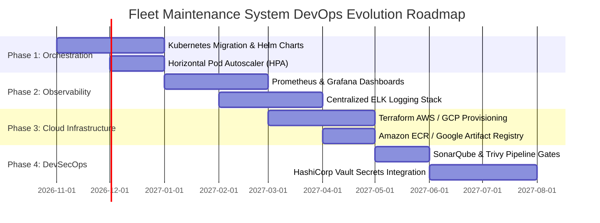

# Task 15: System Limitations & Future Enhancement Plan

**Project:** Fleet Maintenance Management System (ABC Logistics)  
**Author:** DevOps Architecture Team  
**Date:** October 17, 2026  
**Status:** Completed  

---

## 1. Current Architecture Evaluation

The Fleet Maintenance Management System demonstrates a robust, production-tested DevOps pipeline spanning agile issue tracking, continuous integration, automated UI quality gates, versioned containerization, and configuration management. 

While the current architecture satisfies all operational requirements for a localized production deployment, transitioning to a global, multi-region enterprise platform requires addressing specific scalability, high-availability, and observability boundaries.

---

## 2. System Limitations Analysis

### 2.1 Single-Node Container Runtime vs. Distributed Orchestration
- **Current State:** The production application runs as an isolated Docker container (`fleet-production-app`) on a single Linux host.
- **Limitation:** Lack of automated multi-node failover. If the host machine suffers hardware failure or hypervisor reboot, manual intervention is required to restart services.
- **Production Impact:** Single Point of Failure (SPOF) for physical infrastructure; lack of horizontal auto-scaling under traffic spikes.

---

### 2.2 Local Docker Registry vs. Enterprise Cloud Registries
- **Current State:** Images are tagged and pushed to a local private registry container running at `localhost:5000`.
- **Limitation:** The registry operates without TLS encryption and token-based authentication. Image storage is bound to the local filesystem (`/var/lib/docker-registry`).
- **Production Impact:** Inability for remote cluster nodes or multi-datacenter environments to securely pull images across WAN connections without a VPN/SSH tunnel.

---

### 2.3 Health Check Polling vs. Full-Stack Observability
- **Current State:** Operational health is determined via periodic HTTP polling against `/api/auth/health`.
- **Limitation:** Binary health check (UP vs DOWN) does not capture runtime telemetry: JVM heap memory usage, garbage collection pause times, CPU saturation, database connection pool exhaustion, or 99th percentile API latency.
- **Production Impact:** Operators cannot detect performance degradation before an actual service outage occurs.

---

### 2.4 Local File Logging vs. Centralized Log Aggregation
- **Current State:** Application logs are stored locally in `/var/log/fleet-maintenance/*.log` and managed via logrotate.
- **Limitation:** Logs are siloed on the host. Analyzing distributed transactions across multiple microservices or investigating historical outages requires manual SSH access.
- **Production Impact:** Increased Mean Time to Resolution (MTTR) during complex production incidents.

---

### 2.5 Secrets Management in Environment Files
- **Current State:** Sensitive parameters (JWT signing secrets, database credentials) are injected via `/etc/fleet-maintenance/application.env`.
- **Limitation:** Static secrets stored on disk are susceptible to unauthorized read access if file permissions are compromised.
- **Production Impact:** Lacks dynamic secret rotation, automated credential leasing, and tamper-evident audit logging.

---

## 3. Four-Phase Enhancement Roadmap

---

### Phase 1: Kubernetes Cluster Orchestration & Helm Packaging
- **Goal:** Eliminate single-node SPOF and achieve multi-node high availability.
- **Actions:**
  1. Author production Kubernetes manifests (`Deployment`, `Service`, `Ingress`, `ConfigMap`, `Secret`).
  2. Package the application as a versioned **Helm Chart** with environment-specific values (`values-staging.yaml`, `values-prod.yaml`).
  3. Configure **Horizontal Pod Autoscaling (HPA)** based on CPU utilization and request throughput.
  4. Implement Kubernetes Liveness and Readiness probes linked to Spring Boot Actuator endpoints.

---

### Phase 2: Enterprise Observability & Centralized Logging
- **Goal:** Real-time performance monitoring, proactive alerting, and unified log search.
- **Actions:**
  1. Integrate Spring Boot Actuator with Micrometer to expose `/actuator/prometheus` metrics.
  2. Deploy **Prometheus** for metric scraping and **Grafana** for real-time dashboards (JVM memory, active sessions, request latency).
  3. Deploy **Grafana Loki** or **ELK Stack** (Elasticsearch, Logstash, Kibana) with Promtail agents shipping structured JSON logs.
  4. Configure Alertmanager to trigger Slack and PagerDuty notifications on latency thresholds or container restarts.

---

### Phase 3: Cloud Infrastructure as Code (IaC) & Cloud Registries
- **Goal:** Multi-cloud reproducibility and secure image distribution.
- **Actions:**
  1. Author **Terraform** modules to provision VPCs, subnets, security groups, and managed Kubernetes clusters (AWS EKS or GCP GKE).
  2. Migrate from local `localhost:5000` registry to **Amazon ECR** (Elastic Container Registry) with IAM role-based authentication and vulnerability scanning.
  3. Replace embedded H2 database with high-availability managed database (AWS RDS Aurora MySQL) with automated cross-region replication and daily snapshots.

---

### Phase 4: DevSecOps & Zero-Trust Security
- **Goal:** Shift-left security embedded directly into the CI/CD pipeline.
- **Actions:**
  1. Integrate **SonarQube** in Jenkins Stage 2 to enforce static code quality gates and detect code smells.
  2. Implement **Trivy** or **Anchore Engine** container scanning in Stage 5 to block Docker images containing CVE vulnerabilities.
  3. Integrate **HashiCorp Vault** for dynamic database credential generation and automated JWT secret rotation.
  4. Enforce TLS 1.3 encryption across all internal service communications using a Service Mesh (Istio / Linkerd).
